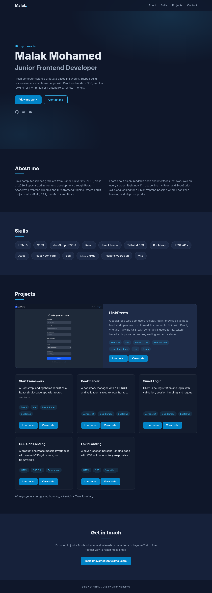
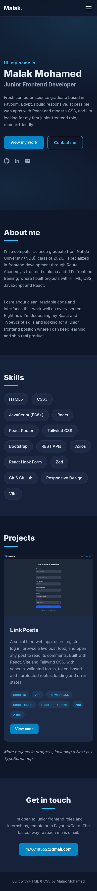

# Malak Mohamed - Portfolio

My personal portfolio site. Single-page, responsive, built with plain HTML, CSS and a
little JavaScript, no build step and no dependencies to install.

**Live site:** https://malakmo7amed309.github.io/

## Screenshots

| Desktop | Mobile |
| --- | --- |
|  |  |

## Sections

- Hero with quick links (GitHub, LinkedIn, email)
- About me
- Skills
- Projects (LinkPosts, more coming)
- Contact

## Run locally

Just open `index.html` in a browser. No install needed.

## Deployment

Deployed with GitHub Pages from the `main` branch.

## Author

Malak Mohamed - Junior Frontend Developer - [GitHub](https://github.com/malakmo7amed309)
